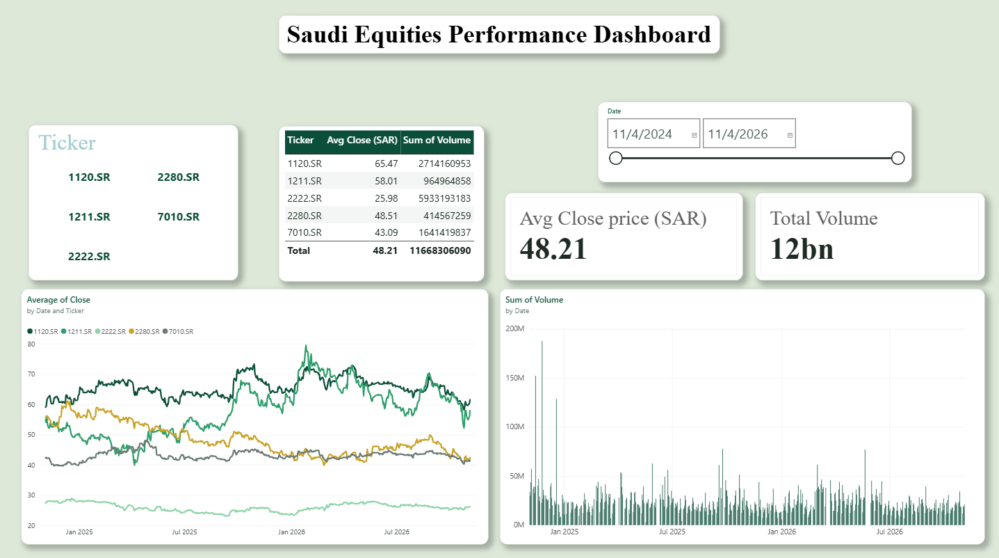
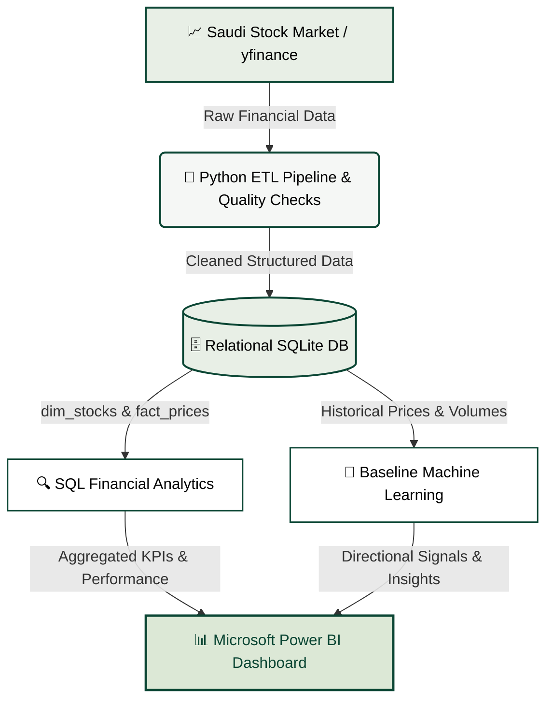

# 📈 Saudi Equities Performance Analytics (End-to-End Pipeline)

An end-to-end data analytics and business intelligence solution tracking and evaluating prominent equities from the **Saudi Stock Exchange (Tadawul)**:
- **Al Rajhi Bank** (`1120.SR`)
- **Ma'aden** (`1211.SR`)
- **Saudi Aramco** (`2222.SR`)
- **Almarai** (`2280.SR`)
- **stc** (`7010.SR`)

This project demonstrates a full-lifecycle analytical workflow, covering **automated data engineering (ETL)**, **relational database modeling with SQLite**, **exploratory SQL financial queries**, **predictive baseline machine learning**, and an **interactive, executive-grade Power BI dashboard**.

---

## 🖼️ Executive Dashboard Preview

---

## 🎯 Core Technical Capabilities & Implementation

### 1. Data Engineering & ETL Pipeline (Python)
- **Automated Ingestion:** Programmatic extraction of historical trading data for selected Tadawul tickers via `yfinance` over a multi-year horizon.
- **Data Cleaning & Wrangling:** Handled missing trading days, normalized datatypes, removed duplicates, and prepared standardized columnar schemas.
- **Automated Data Quality Checks:**
  - Null value audits across core metrics (`Close`, `Volume`, `Date`).
  - Schema consistency checks and duplicate record enforcement.
  - Value range validation (checking for non-negative prices and anomalous zero volumes).
- **Relational Storage (SQLite):** Normalized the cleaned dataset into two distinct relational tables:
  - `dim_stocks`: Descriptive dimension table containing company metadata and sector mappings.
  - `fact_prices`: Transactional fact table tracking historical OHLCV records linked by `ticker` foreign keys.

### 2. Financial Analytics (SQL Engine)
Structured complex SQL queries against the local database engine to compute core financial KPIs:
- **Monthly Returns:** Calculating month-over-month performance using SQL window functions (`LAG()`, `OVER(PARTITION BY ...)`).
- **Historical Volatility:** Standard deviation calculations on daily price fluctuations to assess individual asset risk profiles.
- **Performance Ranking:** Identifying top-performing and underperforming equities across customizable rolling quarters.

### 3. Business Intelligence & UI/UX (Microsoft Power BI)
- **Interactive Filtering:** Dynamic multi-select Ticker slicer and a continuous Date range slider to examine custom micro/macro market cycles.
- **Financial DAX Measures:** Dynamic rollups including weighted average close prices (`Avg Close (SAR)`) and aggregate market volume (`Total Volume`).
- **Visual Components:**
  - **Summary Metrics Table:** Tabular view summarizing average valuations and total traded volume per company.
  - **Price Trend (Line Chart):** Multi-stock comparative trajectory and historical resistance/support levels.
  - **Volume Distribution (Bar Chart):** Liquidity spikes and volume concentration anomaly detection.
- **Modern UI/UX Design System:** Custom pastel mint-green canvas (`#E8EFE6` / `#DCE8D6`), white rounded container cards (`12px` border radius), subtle drop shadows, and high-contrast typography designed for clear executive scanning.

### 4. Baseline Machine Learning (Scikit-Learn)
- **Problem Formulation:** Educational classification baseline predicting next-day directional movement (`Price Up` vs. `Price Down`).
- **Feature Engineering:** Technical lagging indicators including 7-day Simple Moving Average (SMA), 21-day SMA, and rolling momentum ratios.
- **Evaluation Metrics:** Analyzed via Precision, Recall, F1-Score, and Confusion Matrix.
- **Methodological Scope & Limitations:** Built strictly as a practical demonstration of time-series feature engineering and model evaluation; explicitly framed as an educational exercise and **not** financial or trading advice.

---

## 🏗️ Architecture & Data Flow

---

## 🛠️ Tech Stack

- **Programming & ETL:** Python, Google Colab, Pandas, NumPy, yfinance
- **Database & Querying:** SQLite, SQL (Window Functions, Aggregations)
- **Machine Learning:** Scikit-Learn
- **BI & Visualization:** Microsoft Power BI Desktop, DAX
- **Version Control:** Git, GitHub

